# Credit risk decisions, not just a leaderboard

**Ladarius Jackson · Business Analytics**

[](https://github.com/ladariusjackson1/credit-risk-prediction/actions/workflows/ci.yml)
[](https://credit-risk-prediction.streamlit.app)

## Business problem

A lender does not get paid for a high AUC. It gets paid when a booked loan performs, and it takes a loss when a booked loan defaults. This project asks a desk-level question of the public Statlog German Credit file: **given that funding a defaulter is five times as costly as turning away a borrower who would have paid, who should be approved?**

The answer is a gradient-boosting score with a cutoff of **0.15**, not the usual 0.50. On a locked holdout of 200 applicants the policy books 56 loans, 5 of which default. The illustrative cost of that book is **$22,800**.

## Money saved

Dollars below translate the published Statlog matrix at **1 cost unit = $200**. A false approval is $1,000. A false denial is $200 of margin given up. They are not a loss model fit from the file.

| Holdout policy | Booked defaults | Illustrative cost | Saved by the 0.15 cutoff |
| --- | ---: | ---: | ---: |
| Approve everyone | 60 | $60,000 | $37,200 |
| Deny everyone | 0 | $28,000 | $5,200 |
| Score cutoff 0.50 | 20 | $27,200 | $4,400 |
| **Tuned cutoff 0.15** | **5** | **$22,800** | — |

Against approving every holdout applicant, the tuned desk avoids 55 false approvals and gives up 89 performing loans. That is $55,000 of default losses avoided and $17,800 of margin given up, a net **$37,200**. Against a 0.50 cutoff, booked defaults fall from 20 to 5. The $15,000 of default losses avoided outweighs $10,600 of extra turned-away margin, a net **$4,400**.

## Desk demo

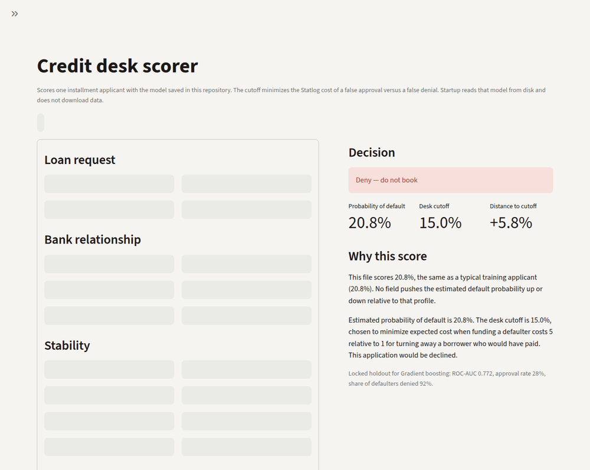

The GIF is this app running locally from `streamlit_app.py`. Five tabs score one file, score a CSV and download the decisions with explanations, compare models with bootstrap intervals, move a cost slider across the threshold and profit curve, and read the age and sex approval gaps in plain English. The app loads `models/credit_risk_model.joblib` from disk and does not download the dataset at startup. For anyone other than the typical training applicant, the panel says which fields push the estimated default probability up or down relative to that profile.

The hosted address [credit-risk-prediction.streamlit.app](https://credit-risk-prediction.streamlit.app) is access pending. Checked on 6 November 2026 with no cookies: the server answers HTTP 303 and sends the browser to Streamlit sign-in at `https://share.streamlit.io/-/auth/app`, then to `/-/login`. The desk is not in that response. A later HTTP 200 on the sign-in page would still not mean the app is public. Use the local command under How to run.

## The decision

The positive class is a default. In the file that label is `bad` (300 of 1,000 applicants). A **false approval** is a default that was booked. A **false denial** is a performing borrower who was turned away.

Statlog publishes the cost matrix used here: a false approval costs 5, a false denial costs 1 ([UCI documentation](https://archive.ics.uci.edu/dataset/144/statlog+german+credit+data)). Dollars in this write-up are a translation of that matrix, not a loss model fit from the file: **1 cost unit = $200**, so a false denial is $200 of margin given up and a false approval is $1,000. Change the ratio and the cutoff moves. That sensitivity is part of the result.

## Data

[Hofmann, H. (1994). Statlog (German Credit Data)](https://doi.org/10.24432/C5NC77), read as OpenML `credit-g` version 1. One thousand installment applicants, 20 attributes, no missing values, a 30% default rate. `python -m credit_risk` downloads the file and writes `data/german_credit.csv`. If OpenML is unreachable, the same command uses that snapshot. If both are missing, it tells you where to put the file.

`personal_status` encodes sex and marital status. `foreign_worker` encodes nationality. They stay in the benchmark model because they are columns in the public file. A second cross-validation drops them. They should not be inputs to a live U.S. decision.

## Design

Nothing in the model choice or the cutoff sees the holdout.

1. Stratified 80/20 split (`random_state=42`): 800 train, 200 test.
2. On the training rows only, three pipelines are compared with 5-fold stratified cross-validation. Each pipeline imputes, scales numerics, and one-hot encodes categories, then fits logistic regression, a random forest, or histogram gradient boosting. All three use balanced class weights so the 30/70 base rate does not dominate fitting.
3. The selected model is the one with the highest mean cross-validated ROC-AUC. Ties would break toward a tighter fold spread, then the model name. Hyperparameters were fixed before the run. This is a comparison of model classes, not a search that was allowed to wander.
4. Each model gets its own cutoff by minimizing Statlog cost on **out-of-fold training scores**. Equal costs keep the higher cutoff, which books more loans once the cost is the same.
5. The chosen pipelines are refit on the 800 and scored **once** on the 200. Permutation importance is computed there, on the original columns, so the chart says `checking_status` rather than a one-hot fragment. No SHAP.

Class weights and the cutoff do different jobs. Weights change how the model is fit. The cutoff is where the desk says yes. Because the weights are balanced, a score of 0.15 is **not** a claim that the applicant has a 15% chance of default. The holdout calibration plot is the check on that.

## Results

Cross-validated ROC-AUC on the 800, then the locked holdout. Each model is shown at the cutoff chosen from its own out-of-fold scores.

| Model | CV ROC-AUC | Holdout ROC-AUC | Holdout average precision | Cutoff | Approved | Defaults denied | Default rate among booked | Illustrative holdout cost |
| --- | ---: | ---: | ---: | ---: | ---: | ---: | ---: | ---: |
| Logistic regression | 0.769 ± 0.059 | 0.806 | 0.633 | 0.28 | 36% | 88% | 9.7% | $22,000 |
| Random forest | 0.792 ± 0.047 | 0.805 | 0.644 | 0.36 | 37% | 90% | 8.1% | $20,400 |
| **Gradient boosting** | **0.793 ± 0.054** | **0.772** | **0.600** | **0.15** | **28%** | **92%** | **8.9%** | **$22,800** |
| Approve everyone | — | — | — | — | 100% | 0% | 30% | $60,000 |
| Deny everyone | — | — | — | — | 0% | 100% | — | $28,000 |

Gradient boosting is the selected model because its training-fold ROC-AUC is the highest. The margin over the random forest is 0.0005, against a fold standard deviation near 0.05, so the two tree models are not separable on this sample. Out-of-fold cost ranks them the same way: boosting 405, logistic regression 410, forest 420, on the 800. The holdout then flips the cost ranking (forest $20,400, logistic $22,000, boosting $22,800). That flip is reported and **not** used to change the model. Two hundred rows can move a couple of defaults. The precommitted rule already picked the out-of-fold cost winner, and every tuned policy beats both naive baselines.

### Tuned logistic baseline, with bootstrap intervals

The baseline is logistic regression allowed a penalty search the race models do not get. On the training folds only, C is chosen from 0.1, 1, and 10 by mean ROC-AUC. Ties would prefer the C closest to 1. The winner is **C = 0.1** (0.781 ± 0.057). C = 1, the race logistic, is 0.769 ± 0.059. C = 10 is 0.760 ± 0.064. C is chosen on the same folds that are reported, so this CV number can look a little better than a nested search. The holdout is not used to pick C, and the baseline is not allowed to replace the shipped model after the holdout is opened.

The intervals below are a stratified percentile bootstrap of the out-of-fold scores, 1,000 replicates, seed 42. Each replicate keeps the class counts. The model is not refit, and C is not chosen again.

| Model | CV ROC-AUC | OOF ROC-AUC (95% CI) | OOF Brier (95% CI) | Cutoff | Holdout ROC-AUC | Holdout illustrative cost |
| --- | ---: | ---: | ---: | ---: | ---: | ---: |
| Logistic regression (C = 1) | 0.769 ± 0.059 | 0.767 (0.732 to 0.801) | 0.196 (0.180 to 0.212) | 0.28 | 0.806 | $22,000 |
| Random forest | 0.792 ± 0.047 | 0.791 (0.757 to 0.823) | 0.180 (0.172 to 0.190) | 0.36 | 0.805 | $20,400 |
| **Gradient boosting** | **0.793 ± 0.054** | **0.790 (0.756 to 0.822)** | **0.178 (0.163 to 0.195)** | **0.15** | **0.772** | **$22,800** |
| Tuned logistic baseline (C = 0.1) | 0.781 ± 0.057 | 0.780 (0.746 to 0.813) | 0.189 (0.176 to 0.202) | 0.34 | 0.809 | $21,000 |

On out-of-fold scores, gradient boosting minus the tuned logistic baseline has a ROC-AUC difference of **+0.010** (95% interval **−0.010 to 0.031**). The interval includes zero, so this training sample does not separate them on ROC-AUC.

The out-of-fold Brier difference, boosting minus the baseline, is **−0.011** (95% interval **−0.020 to −0.002**). That interval excludes zero: on these out-of-fold rows the boosting scores sit closer to the outcomes. Lower Brier is better. The out-of-fold cost per applicant, at each model's own cutoff, differs by **+0.001** (95% interval **−0.054 to 0.056**). The interval includes zero. The point costs on the 800 are 405 for boosting and 404 for the tuned logistic.

The holdout then prices the tuned logistic at **$21,000** and boosting at **$22,800**. Same rule as the forest: a holdout cost gap is reported and is not a reason to reopen a choice that was made on the training scores.

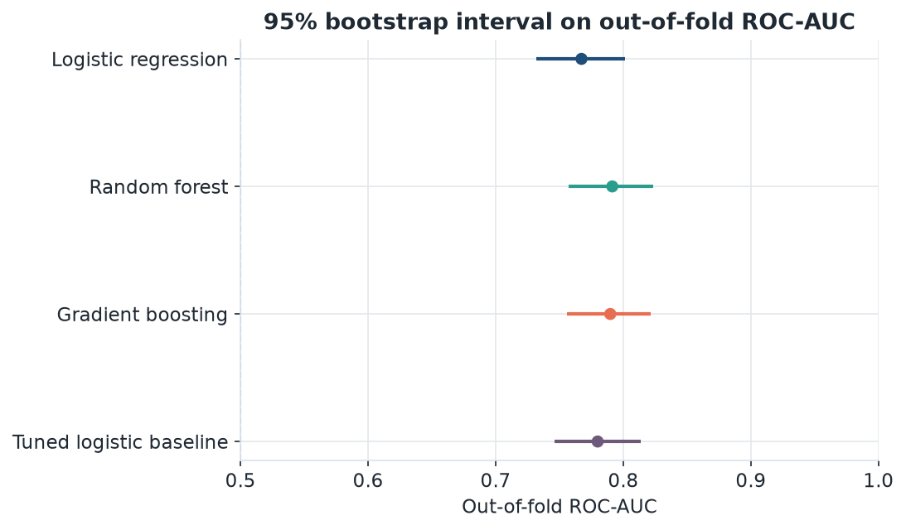

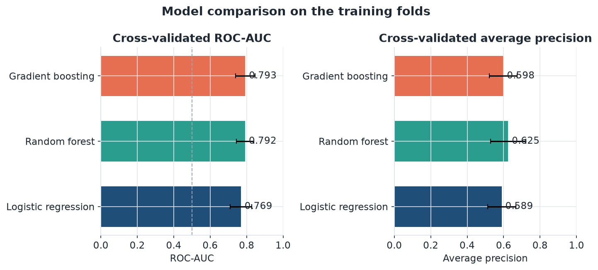

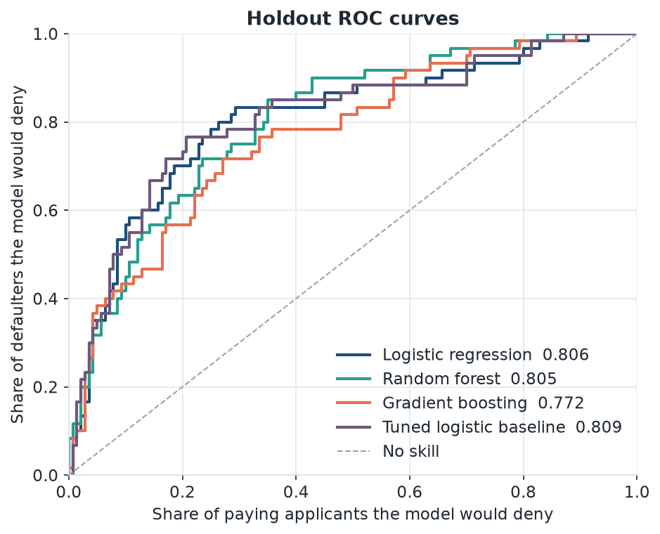

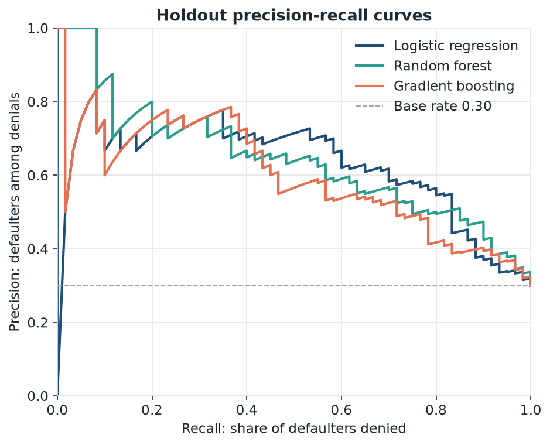

### The cutoff is the product

On the training out-of-fold scores, cost bottoms at 0.15. Denying everyone costs 560. Approving everyone costs 1,200. The 0.50 score cutoff is not on that minimum.

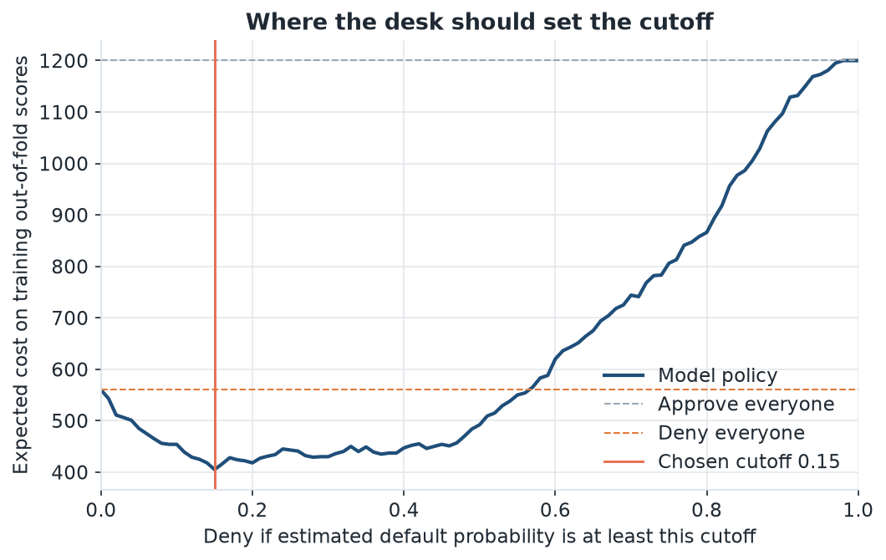

The same out-of-fold scores, drawn as illustrative dollars saved versus approving everyone. The app redraws this curve when the loss ratio changes.

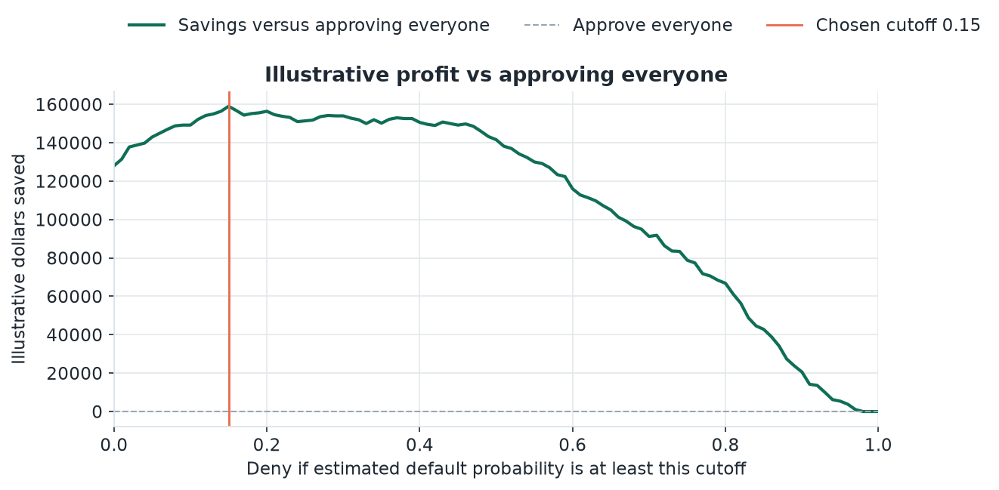

On the holdout, the same 0.15 rule versus a 0.50 rule:

| Holdout decision | Approved and paid | Denied but would have paid | Approved and defaulted | Denied and would have defaulted | Cost | Illustrative $ |
| --- | ---: | ---: | ---: | ---: | ---: | ---: |
| Cutoff 0.50 | 104 | 36 | 20 | 40 | 136 | $27,200 |
| **Cutoff 0.15** | **51** | **89** | **5** | **55** | **114** | **$22,800** |

The 0.50 rule books 20 defaulters. At $1,000 each that is already $20,000, plus $7,200 of turned-away margin, $27,200 total — $800 under the cost of lending to nobody. The cost-minimizing rule books 5 defaulters and turns away more good applications. That trade is what the 5:1 matrix asks for. The booked book’s default rate is 8.9% (5 of 56) against a 30% base rate.

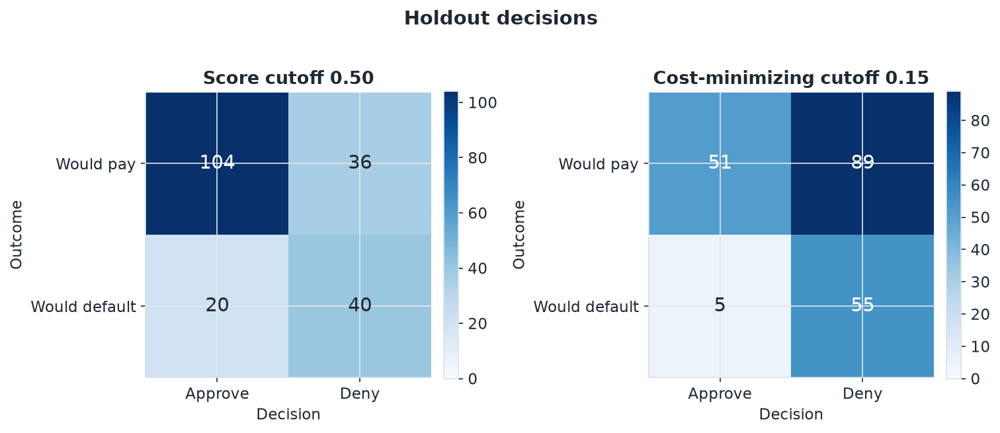

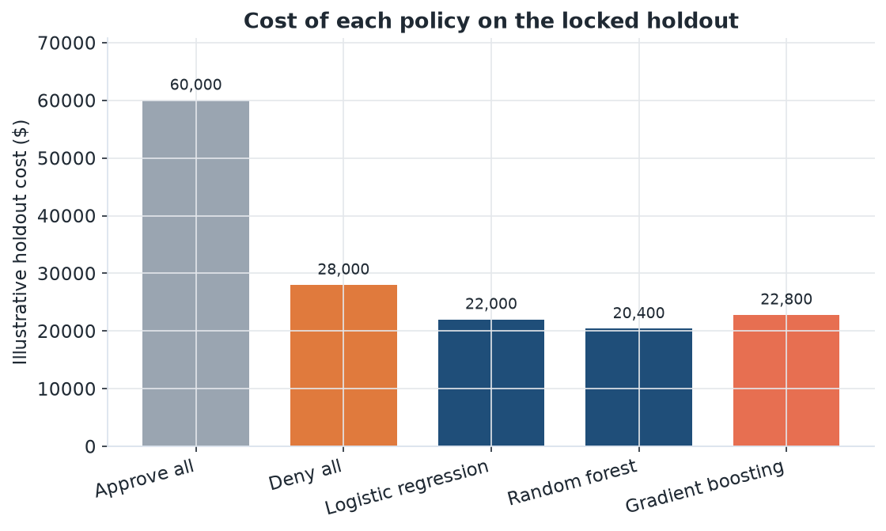

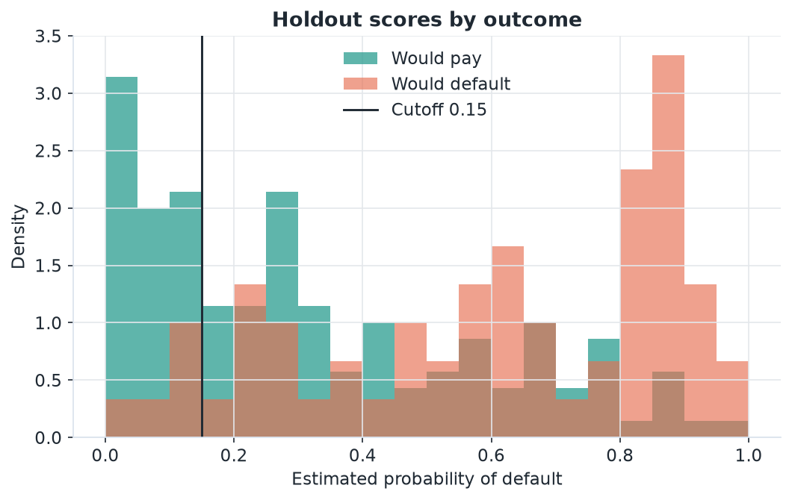

### If management changes the loss ratio

The cutoff below is retuned on the same out-of-fold boosting scores. Only the costs change.

| False approval : false denial | Illustrative loss on a default | Cutoff | Share approved | Share of defaulters denied |
| --- | ---: | ---: | ---: | ---: |
| 2 : 1 | $400 | 0.47 | 62% | 73% |
| **5 : 1 (published)** | **$1,000** | **0.15** | **31%** | **93%** |
| 10 : 1 | $2,000 | 0.15 | 31% | 93% |

Moving from 5:1 to 2:1 opens the book from about 31% approved to 62%. Moving from 5:1 to 10:1 does not move the cutoff: on these scores, 0.15 is already the conservative pocket, and the next lower cutoffs deny more good borrowers than the extra defaults they catch are worth. The desk should retune when the loss ratio changes, not when a new model is fashionable.

### What the score is actually using

Permutation importance shuffles one original column at a time and records the drop in holdout ROC-AUC. Checking-account status is the only column that moves AUC by a wide margin (about 0.08, with a repeat-to-repeat spread of 0.02). Purpose, credit amount, credit history, and duration form a second tier around 0.02. Several columns, including age, sit on zero.

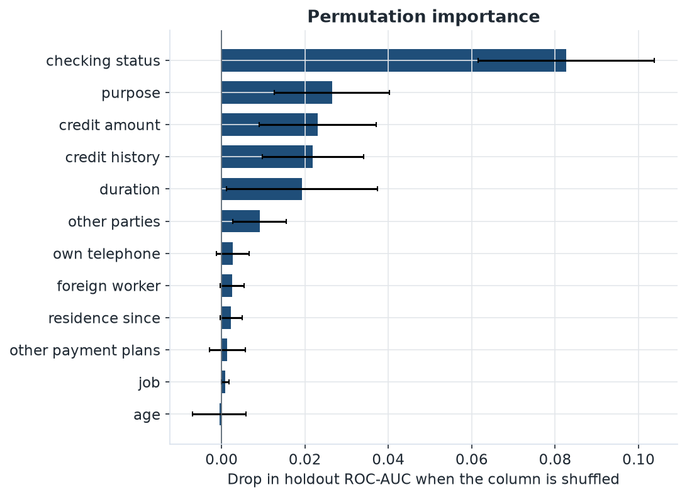

The raw rates explain the checking-account result, and they also warn against reading the codebook as modern American English. In this file, **no checking account is the low-risk group** (12% default, 46 of 394). A negative checking balance is the high-risk group (49%, 135 of 274). Balances of 0 to 200 default at 39%; balances of 200 or more default at 22%. The book rate is 30%.

Credit history has the same kind of trap. "Critical / other existing credit" defaults at 17% (50 of 293). "No credits / all paid" defaults at 62% (25 of 40). The model can use the column because it is allowed to learn those rates. A reviewer who relabels them by the English words will make the model worse.

Loan term and size show up in the same direction a credit officer expects, with a bend in the middle of the amount distribution. Terms of 12 months or less default at 21% (76 of 359). Terms above 24 months default at 44% (102 of 230). The largest amount quartile, above about 3,972 DM, defaults at 42%. The quartile below it defaults at 22%. Amount is not a straight line.

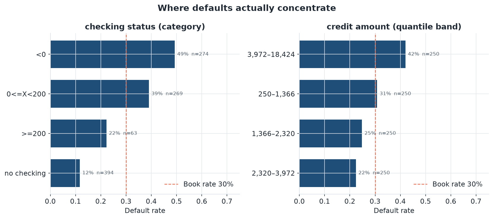

### Protected attributes

Dropping `personal_status` and `foreign_worker` and repeating the same 5 folds changes boosting's mean ROC-AUC from 0.793 to 0.786. That is a loss of about 0.007. On the holdout permutation test, shuffling `personal_status` does not hurt AUC (the mean drop is negative), and `foreign_worker` is inside its own noise. Ranking quality does not depend on sex, marital status, or nationality here. A policy build should refit without those two columns. The saved scorer still asks for them so that a score matches the benchmark model that was trained.

The shipped cutoff still treats people differently. On the 800 training out-of-fold scores, at cutoff 0.15:

| Group | n | Default rate | Approval rate | False approval rate | False denial rate |
| --- | ---: | ---: | ---: | ---: | ---: |
| Female-labeled | 249 | 35.7% | 24.9% | 6.7% | 65.0% |
| Male-labeled | 551 | 27.4% | 34.3% | 6.6% | 55.2% |
| Under 25 | 110 | 38.2% | 13.6% | 4.8% | 80.9% |
| 25 and older | 690 | 28.7% | 34.2% | 7.1% | 54.9% |

Female-labeled minus male-labeled, the approval-rate gap is **−9.4 percentage points**. The false-approval rates, the share of defaulters who were still booked, are 6.7% and 6.6%. That gap is +0.1 percentage point. The approval gap is the false denials: 65.0% of female-labeled applicants who paid were turned away, against 55.2% of male-labeled applicants who paid. The approval ratio is 0.73. A figure of 0.80 is a U.S. screening rule of thumb. It is not a legal result on this file.

Applicants under 25 were approved 13.6% of the time and applicants 25 and older 34.2%. The gap is **−20.6 percentage points**. False approvals among defaulters are 4.8% and 7.1%. False denials among people who paid are 80.9% and 54.9%. The approval ratio is 0.40. Age is an input to the model, and the under-25 group defaults more often in this split (38.2% against 28.7%), so part of the gap is the feature doing what it was trained to do.

The locked holdout is smaller. Female-labeled applicants were approved 26.2% of the time (n=61) and male-labeled applicants 28.8% (n=139), a gap of −2.5 percentage points. Under 25 the approval rate is 15.4% (n=39) against 31.1% for 25 and older (n=161). Twenty defaulters in the female-labeled holdout cell, and 19 under 25, are too few for a stable error rate.

`personal_status` mixes sex and marital status, so the female and male rows collapse those labels. The age cut at 25 is a reporting choice. These gaps describe one cutoff on one split of a 1994 German file. They are not a fair-lending finding, not a U.S. applicant population, and not a reason by themselves to approve or deny anyone. The same note is in the app and in [MODEL_CARD.md](MODEL_CARD.md).

### Calibration

Holdout Brier score for the selected model is 0.187. Predicting the holdout's own 30% default rate for everyone scores 0.210. On the training out-of-fold scores the Brier score is 0.178, against the same 0.210 for a constant prediction of the training default rate. The probabilities are somewhat informative and still noisy. Use them to rank and to set a cutoff. Do not book a loss reserve off the raw score. The app draws this curve, and a slider redraws illustrative profit against the cutoff when the loss ratio changes. Profit there means dollars saved versus approving everyone, at $200 per cost unit. It is not revenue.

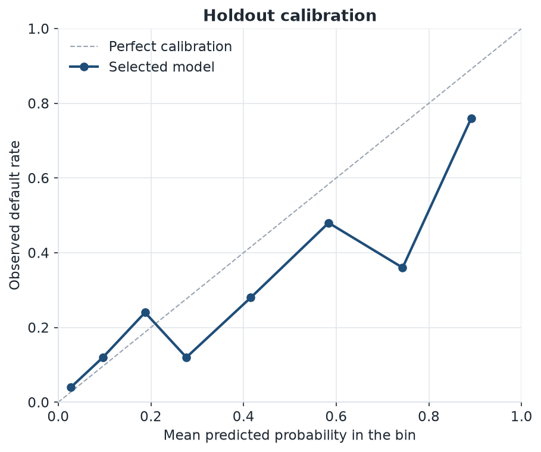

## Findings

- Under the published 5:1 matrix, the value is in the cutoff. A 0.50 threshold almost fails to beat "lend to nobody." The tuned rule cuts booked defaults from 20 to 5 on the holdout and lowers illustrative cost from $27,200 to $22,800.
- The tuned book is small on purpose: 28% of holdout applicants, an 8.9% default rate inside the booked loans, and 92% of defaulters turned away.
- Boosting, the forest, and logistic regression are close. The written rule selects boosting. The holdout cost ranking prefers the forest by $2,400, which is not a reason to reopen the choice after seeing the test set.
- Checking-account status dominates. Read the empirical rates, not the English gloss. "No checking account" is 12% default in this file.
- Sex, marital status, and nationality can come out of the ranking. The cross-validated AUC cost is about 0.007. At the shipped cutoff the book is still uneven: on the training out-of-fold scores, female-labeled applicants are approved 9.4 percentage points less often than male-labeled applicants, and applicants under 25 are approved 20.6 percentage points less often than older applicants. The female gap is almost entirely extra false denials, not extra booked defaults.
- A tuned logistic baseline (C = 0.1) is not separable from boosting on out-of-fold ROC-AUC. The difference is +0.010 and the 95% bootstrap interval (−0.010 to 0.031) includes zero. Boosting's out-of-fold Brier score is lower by 0.011, and that interval excludes zero. Out-of-fold cost does not separate them. The holdout prices the baseline $1,800 lower, which does not change the shipped model.
- If a false approval is only twice a false denial, the same scores support approving about 62% instead of 31%. The cutoff is a management input.

## What this should not be used for

This is a 1994 German installment book with 1,000 rows. It is not a 2026 U.S. application population, it is not a pricing model, and it is not fair-lending validation. The dollar figures exist so a reader can feel the cost matrix. They are not expected loss. Scores were not calibrated to a live portfolio's base rate.

## How to run

Python 3.10 or newer.

```bash
python -m pip install -r requirements.txt
PYTHONPATH=src python -m credit_risk
PYTHONPATH=src python -m pytest
python -m ruff check src tests streamlit_app.py
python -m streamlit run streamlit_app.py
```

`requirements.txt` pins every direct dependency, including scikit-learn 1.9.1, the version that wrote `models/credit_risk_model.joblib`. `python -m credit_risk` rewrites `reports/`, the figures, and the model. `--refresh` redownloads OpenML `credit-g` before training. Without `--refresh`, training reads `data/german_credit.csv`.

The repo is laid out for Streamlit Community Cloud (main file `streamlit_app.py`, Python 3.12 in `.python-version`). Public access on that host is pending; see the note under Desk demo. `.streamlit/config.toml` turns usage stats off and sets the desk theme. The app adds `src` to its import path, loads the committed model, and does not contact the network on startup. It opens on a typical training applicant. Reset returns to that profile. When a field differs from that profile, the decision panel states the local contribution: the change in estimated default probability from putting that one field back, with the other fields left as entered.

The header shows the shipped model, the cutoff, holdout ROC-AUC, holdout Brier, and illustrative holdout cost. **Batch** accepts a CSV of up to 5,000 rows, keeps extra columns, and downloads a score, a decision, and an explanation for each valid row. **Policy** has a slider for the false-approval cost, from 1 to 20 times a false denial, and redraws the threshold and profit curve on the training out-of-fold scores or on the locked holdout. Moving the slider does not change the saved model. **Fairness** prints the group note and the rates. The model card is [MODEL_CARD.md](MODEL_CARD.md).

The numbers in this README were produced by that command on Python 3.12 with scikit-learn 1.9.1, pandas 3.1.0, and NumPy 2.5.4 (`reports/metrics.json` records the versions).

## Layout

```
streamlit_app.py                 Streamlit entry point (`streamlit run streamlit_app.py`)
MODEL_CARD.md                    data, intended use, metrics, limits
src/credit_risk/                 data, features, models, cost, bootstrap, fairness, batch scoring
data/german_credit.csv           offline snapshot of OpenML credit-g
models/credit_risk_model.joblib
reports/                         metrics, tables, figures, a copy of the model card
docs/credit-desk-demo.gif
tests/                           pytest, at least 95% line coverage of src/credit_risk
.streamlit/config.toml
.github/workflows/ci.yml
```

Continuous integration on GitHub Actions runs Ruff and pytest. The suite covers the OpenML fallback, the cost arithmetic, cutoff ties, each model, the end-to-end study on a synthetic book, and the saved-model scorer. It does not need a network call.

## Reproduce the tables

| File | What it is |
| --- | --- |
| `reports/metrics.json` | The study record, including fold means and the holdout |
| `reports/model_comparison.csv` | CV metrics, bootstrap intervals, tuned baseline, holdout cost |
| `reports/bootstrap_metrics.csv` | Level and difference intervals, out-of-fold and holdout |
| `reports/logistic_c_grid.csv` | Training-fold ROC-AUC at C = 0.1, 1, and 10 |
| `reports/fairness_groups.csv` | Approval and error rates by sex label and age band |
| `reports/fairness_gaps.csv` | Group gaps at the shipped cutoff |
| `MODEL_CARD.md` | Model card rendered from `reports/metrics.json` |
| `reports/test_metrics.csv` | Holdout operating point for each model |
| `reports/threshold_sweep.csv` | Cost at every cutoff |
| `reports/cost_sensitivity.csv` | Cutoff at loss ratios 2:1, 5:1, and 10:1 |
| `reports/permutation_importance.csv` | Holdout permutation importance |
| `reports/categorical_default_rates.csv` | Default rate by category level |
| `reports/numeric_band_default_rates.csv` | Default rate by quantile band |
